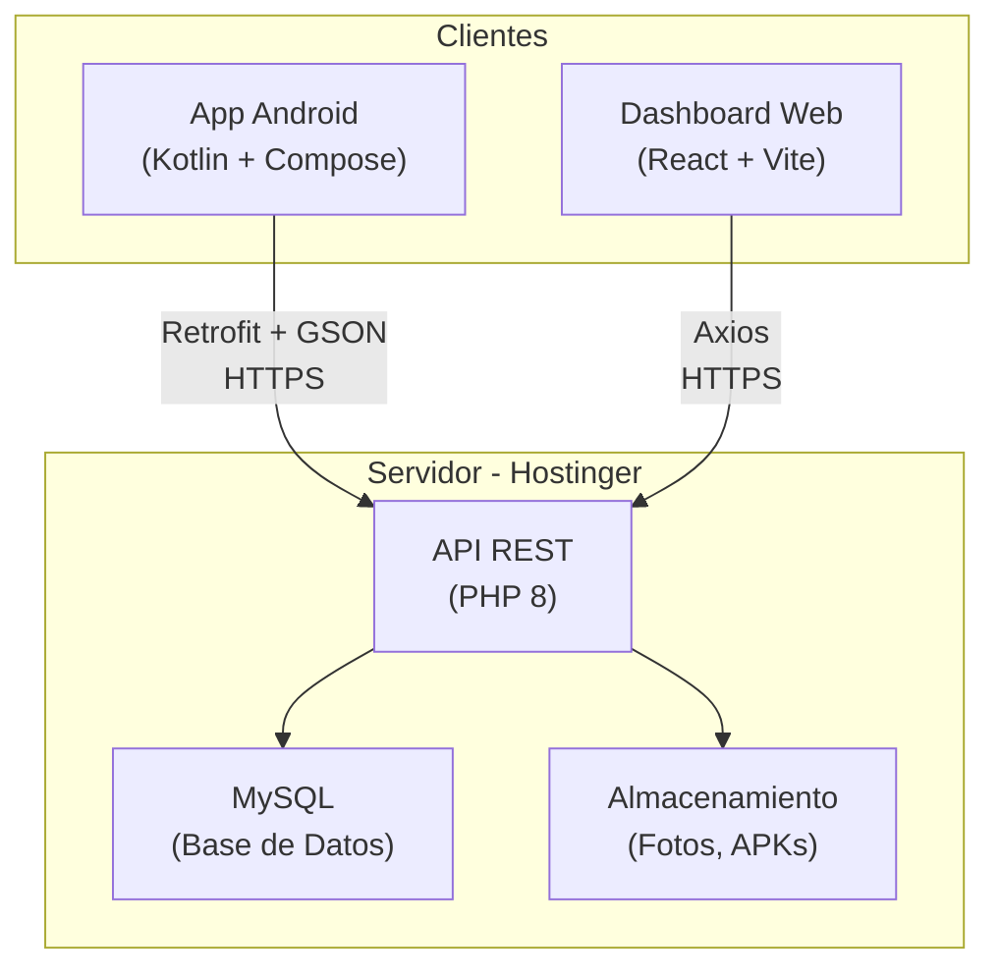
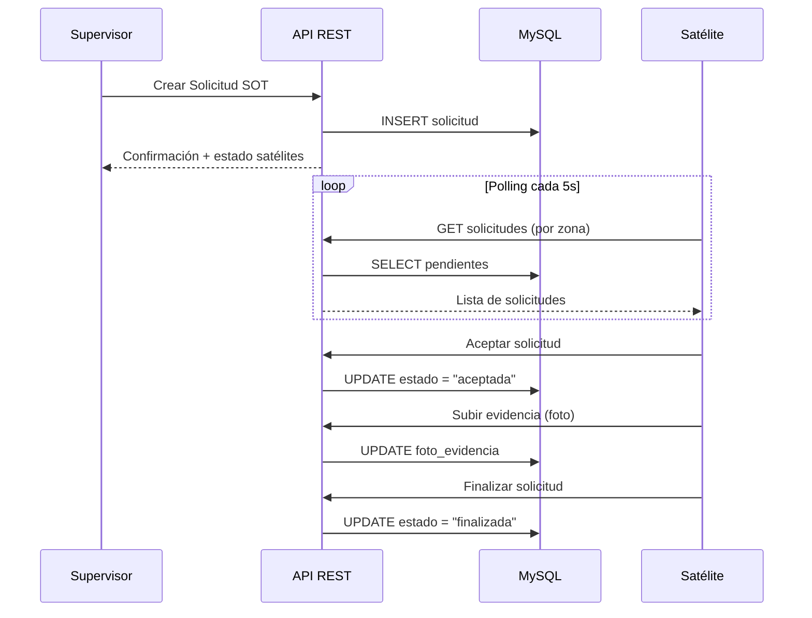
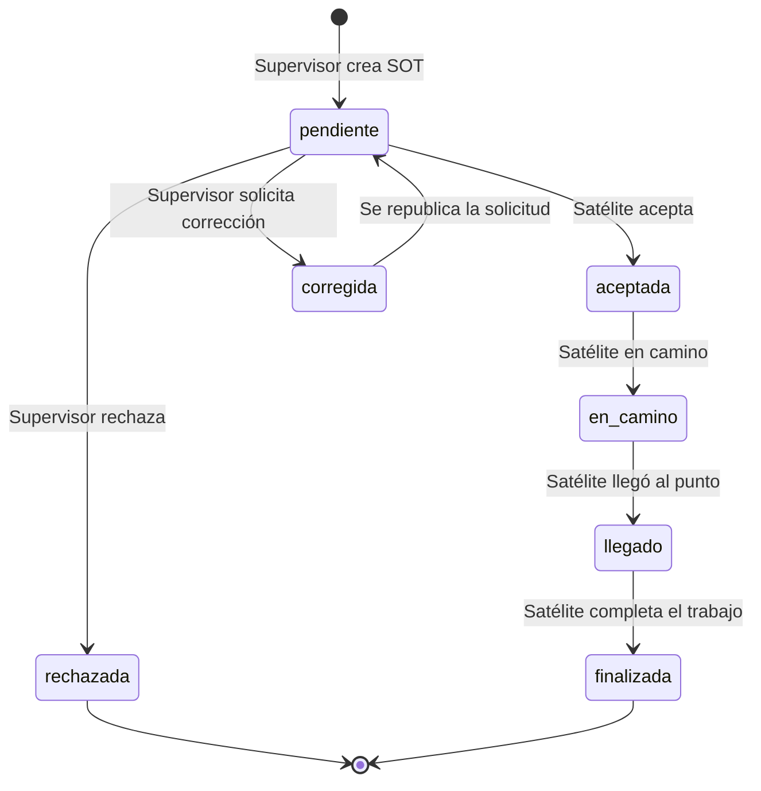
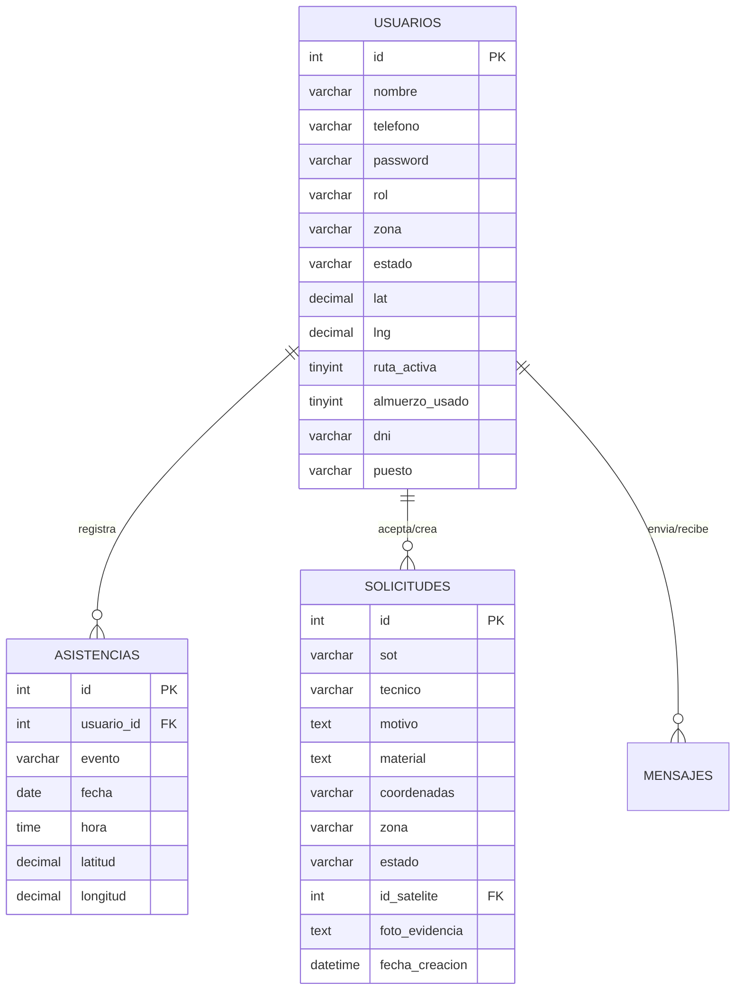

# APPMOVIL — Documentación Técnica Completa

## Sistema de Gestión de Campo y Despacho de Satélites

---

> [!IMPORTANT]
> **Versión del Documento:** 1.0  
> **Última Actualización:** Abril 2026  
> **Aplicación:** APPMOVIL v1.0 (versionCode: 4)

---

## 1. Descripción General del Sistema

APPMOVIL es una plataforma integral de **Field Service Management (FSM)** diseñada para la gestión, despacho y monitoreo en tiempo real de personal de campo denominado "Satélites". El sistema permite a supervisores crear solicitudes de servicio técnico (SOTs), asignarlas a satélites por zonas geográficas, rastrear su ubicación GPS en vivo, controlar asistencia, y generar reportes Excel corporativos.

### 1.1 Componentes del Sistema

| Componente | Tecnología | Descripción |
|---|---|---|
| **App Android** | Kotlin, Jetpack Compose, Material 3 | Aplicación móvil para satélites, supervisores y administradores |
| **Dashboard Web** | React 19, Vite 8, Tailwind CSS 4 | Panel de administración web para gestión corporativa |
| **Backend API** | PHP 8, MySQL | API RESTful alojada en Hostinger (`cicsamovil.com`) |
| **Base de Datos** | MySQL (InnoDB, UTF-8) | Almacenamiento relacional con zona horaria UTC-5 |

### 1.2 Roles del Sistema

| Rol | Acceso | Descripción |
|---|---|---|
| **Admin** | App + Dashboard Web | Control total: gestión de personal, reportes, monitoreo de mapa, asistencia |
| **Supervisor** | App | Crea y gestiona solicitudes SOT, ve el estado de los satélites |
| **Satélite** | App | Personal de campo: acepta solicitudes, reporta ubicación, sube evidencia |

---

## 2. Arquitectura del Sistema

### 2.1 Diagrama de Arquitectura



### 2.2 Flujo de Datos Principal



---

## 3. Aplicación Android

### 3.1 Estructura del Proyecto

```
app/src/main/java/com/example/appmovil/
├── MainActivity.kt                    # Activity principal, navegación, actualizaciones
├── data/
│   ├── SessionManager.kt             # Gestión de sesión local (SharedPreferences)
│   ├── remote/
│   │   ├── RetrofitClient.kt         # Configuración Retrofit (base URL, OkHttp)
│   │   ├── AuthApi.kt                # Interfaz API de autenticación y usuarios
│   │   ├── SolicitudApi.kt           # Interfaz API de solicitudes
│   │   ├── AuthDtos.kt               # DTOs: UserProfile, AuthResponse, etc.
│   │   ├── SolicitudDtos.kt          # DTOs: SolicitudItem, CreateRequest, etc.
│   │   └── MessageDto.kt             # DTOs: MessageItem, UserContact
│   └── repository/
│       ├── AuthRepository.kt         # Repositorio de autenticación y usuarios
│       └── SolicitudRepository.kt    # Repositorio de solicitudes
├── services/
│   ├── LocationService.kt            # Servicio foreground de rastreo GPS
│   └── SolicitudPollingService.kt    # Servicio foreground de polling de solicitudes y chat
├── ui/
│   ├── login/
│   │   ├── LoginScreen.kt            # Pantalla de inicio de sesión
│   │   ├── LoginViewModel.kt         # ViewModel de login
│   │   ├── RegisterScreen.kt         # Pantalla de registro de usuarios
│   │   ├── RegisterViewModel.kt      # ViewModel de registro
│   │   ├── ProfileScreen.kt          # Pantalla de perfil de usuario
│   │   └── ProfileViewModel.kt       # ViewModel de perfil
│   ├── home/
│   │   ├── HomeScreen.kt             # Pantalla principal (77KB, ~2000 líneas)
│   │   └── SolicitudItemCard.kt      # Componente: card de solicitud expandible
│   ├── admin/
│   │   ├── AdminMapScreen.kt         # Mapa de rastreo GPS en tiempo real
│   │   ├── AttendanceScreen.kt       # Control de asistencia (horarios de ruta)
│   │   └── StatisticsScreen.kt       # Panel de estadísticas y reportes Excel
│   ├── solicitudes/
│   │   ├── CreateSolicitudScreen.kt  # Formulario de creación/edición de SOTs
│   │   └── SolicitudViewModel.kt     # ViewModel central de solicitudes
│   ├── chat/                          # Componentes de mensajería privada
│   ├── components/                    # Componentes UI reutilizables
│   └── theme/                         # Tema Material 3 personalizado
└── utils/
    ├── AppUpdateManager.kt            # Gestor de actualizaciones in-app (APK)
    └── ReportExporter.kt             # Generador de reportes Excel desde la app
```

### 3.2 Configuración de Red

| Parámetro | Valor |
|---|---|
| **Base URL** | `https://www.cicsamovil.com/` |
| **Librería HTTP** | Retrofit 2 + OkHttp |
| **Serialización** | GSON |
| **Logging** | `HttpLoggingInterceptor` (nivel HEADERS) |
| **Timeout** | Default de OkHttp (10s connect, 10s read) |

### 3.3 Navegación (Jetpack Navigation Compose)

```
login → home/{userId}/{userName}/{userRol}/{userZona}
                ↓
     create_solicitud/{userName}
                ↓
          register (registro de usuarios)
```
- Sesión persistente vía `SessionManager` (SharedPreferences `user_session`)
- Parámetros URL-encoded para caracteres especiales en nombres y zonas

### 3.4 Servicios en Segundo Plano

#### LocationService (Foreground Service - Tipo: LOCATION)
- **Frecuencia:** Cada 10 segundos (mínimo 5s)
- **Precisión:** `PRIORITY_HIGH_ACCURACY`
- **API:** Google Fused Location Provider
- **Envío:** `POST /api/update_location.php` (userId, lat, lng)

#### SolicitudPollingService (Foreground Service - Tipo: DATA_SYNC)
- **Frecuencia:** Polling cada 5 segundos
- **Funciones:**
  - Detecta nuevas solicitudes pendientes → notificación con sonido personalizado (`alerta_mision.mp3`)
  - Detecta nuevos mensajes de chat → notificación
  - Solo satélites reciben alertas de solicitudes (filtrado por zona)
  - Supervisores y admins no reciben alertas de solicitudes
- **WakeLock:** 10 minutos para mantener CPU activo con pantalla bloqueada

### 3.5 Permisos Android Requeridos

| Permiso | Uso |
|---|---|
| `INTERNET` | Comunicación con API REST |
| `ACCESS_FINE_LOCATION` | GPS de alta precisión |
| `ACCESS_COARSE_LOCATION` | Ubicación aproximada (fallback) |
| `FOREGROUND_SERVICE` | Servicios en primer plano |
| `FOREGROUND_SERVICE_LOCATION` | Rastreo GPS en background |
| `FOREGROUND_SERVICE_DATA_SYNC` | Polling de solicitudes en background |
| `POST_NOTIFICATIONS` | Alertas de nuevas solicitudes y mensajes |
| `WAKE_LOCK` | Mantener CPU activo para polling |
| `REQUEST_INSTALL_PACKAGES` | Actualizaciones in-app de APK |

### 3.6 Sistema de Actualizaciones In-App (OTA)

1. Al iniciar la app → `AppUpdateManager.checkForUpdates()` consulta `GET /api/check_update.php`
2. Compara `versionCode` del servidor vs `BuildConfig.VERSION_CODE` local
3. Si hay nueva versión → muestra un `AlertDialog` con notas de la versión
4. Usuario acepta → descarga APK vía `DownloadManager` a carpeta Downloads
5. Al completar descarga → abre instalador usando `FileProvider` (compatible Android 7+)
6. Fallback manual: Si `getUriForDownloadedFile` falla, usa `FileProvider` directo

### 3.7 Funcionalidades por Rol

#### Satélite
- Activar/Desactivar ruta (marca asistencia INGRESO/SALIDA automáticamente)
- Ver solicitudes pendientes de su zona
- Aceptar, indicar "en camino", "llegado" y finalizar solicitudes
- Subir múltiples fotos de evidencia por solicitud
- Agregar comentarios a solicitudes
- Chat privado con supervisores y administradores
- Timer de almuerzo (máximo 1 hora, alerta sonora a los 5 minutos restantes)
- Cierre automático de sesión/ruta a las 23:00

#### Supervisor
- Crear y editar solicitudes SOT (formulario con SOT, técnico, motivo, material, coordenadas, zona)
- Ver estado de todos los satélites
- Corregir o rechazar solicitudes
- Chat con satélites y administradores
- Lista de contactos del equipo

#### Admin
- Todo lo del Supervisor, más:
- Mapa GPS en tiempo real (Google Maps con marcadores de todos los satélites)
- Control de asistencia (resumen de horarios de activar/cerrar ruta por satélite)
- Panel de estadísticas con métricas operativas
- Gestión de zonas y asignación de personal
- Exportar reportes Excel (asistencia mensual, horarios de ruta, solicitudes)
- Registrar nuevos usuarios desde la app
- Resetear estado de almuerzo de satélites

---

## 4. Dashboard Web

### 4.1 Estructura del Proyecto

```
dashboard/
├── index.html                   # Punto de entrada HTML
├── package.json                 # Dependencias y scripts npm
├── vite.config.js               # Configuración de Vite
├── src/
│   ├── main.jsx                 # Bootstrap de React
│   ├── App.jsx                  # Router principal (HashRouter)
│   ├── App.css                  # Estilos específicos de la app
│   ├── index.css                # Estilos globales, variables CSS, utilidades
│   ├── services/
│   │   ├── api.js               # Servicios HTTP: authService + dataService
│   │   └── DataContext.jsx      # Context global con caché localStorage y polling
│   └── pages/
│       ├── Login.jsx            # Autenticación (solo usuarios con rol admin)
│       ├── Dashboard.jsx        # Layout principal: header + sidebar + contenido
│       ├── Overview.jsx         # Vista general con KPIs y métricas
│       ├── Map.jsx              # Mapa interactivo Leaflet con ubicaciones GPS
│       ├── Solicitudes.jsx      # Gestión CRUD de bolsa de tareas SOT
│       ├── SatelitesStatus.jsx  # Monitoreo en tiempo real de satélites
│       ├── Asistencia.jsx       # Control de asistencia y horarios de ruta
│       ├── Users.jsx            # Gestión de personal y zonas
│       └── Reports.jsx          # Generación y descarga de reportes Excel
└── dist/                        # Build de producción (generado por Vite)
```

### 4.2 Dependencias Principales

| Paquete | Versión | Uso |
|---|---|---|
| `react` | 19.2.4 | Framework de interfaz de usuario |
| `react-router-dom` | 7.14.0 | Enrutamiento SPA (usa HashRouter) |
| `axios` | 1.14.0 | Cliente HTTP para consumir la API |
| `framer-motion` | 12.38.0 | Animaciones y transiciones |
| `lucide-react` | 1.7.0 | Librería de iconos SVG |
| `leaflet` + `react-leaflet` | 1.9.4 / 5.0.0 | Mapas interactivos |
| `tailwindcss` | 4.2.2 | Framework de utilidades CSS |

### 4.3 Sistema de Caché (DataContext)

El `DataProvider` implementa un sistema de caché inteligente:
- **Lectura inicial:** Carga datos de `localStorage` inmediatamente (UI sin parpadeo)
- **Polling silencioso:** Cada 15 segundos consulta la API en segundo plano
- **Comparación profunda:** Solo actualiza el state si los datos son diferentes (`JSON.stringify`)
- **Claves de cache:** `cache_solicitudes`, `cache_users`

### 4.4 Rutas del Dashboard

| Ruta | Componente | Descripción |
|---|---|---|
| `/dashboard` | Overview | KPIs, métricas generales, resumen operativo |
| `/dashboard/map` | Map | Mapa Leaflet con ubicación GPS de todos los satélites |
| `/dashboard/solicitudes` | Solicitudes | Tabla CRUD de solicitudes SOT con filtros |
| `/dashboard/satelites` | SatelitesStatus | Estado en tiempo real de cada satélite |
| `/dashboard/asistencia` | Asistencia | Control de horarios de activación/cierre de ruta |
| `/dashboard/users` | Users | Gestión de personal, asignación de zonas y roles |
| `/dashboard/reports` | Reports | Generación de reportes Excel mensuales |

### 4.5 Diseño Visual

- **Font:** Inter (Google Fonts)
- **Color primario:** Royal Blue (`#1e40af`)
- **Layout:** Sidebar fijo (260px) + contenido fluido
- **Responsive:** Sidebar se convierte en drawer en mobile
- **Tablas:** Estilo zebra con hover, bordes corporativos

---

## 5. API Backend (PHP)

### 5.1 URL Base

```
https://www.cicsamovil.com/api/
```

### 5.2 Configuración General

- **Motor DB:** MySQL (InnoDB)
- **Charset:** UTF-8 (`utf8mb4`)
- **Zona Horaria:** `UTC-5` (Perú/Colombia) — configurado en `db_config.php`
- **CORS:** Habilitado para todos los orígenes (`Access-Control-Allow-Origin: *`)
- **Métodos CORS:** `POST, GET, OPTIONS`
- **Content-Type principal:** `application/json`

### 5.3 Catálogo Completo de Endpoints

#### 5.3.1 Autenticación y Usuarios

| Método | Endpoint | Descripción | Parámetros |
|---|---|---|---|
| `POST` | `/login.php` | Inicio de sesión | `celular`, `password` |
| `POST` | `/register.php` | Registro de nuevo usuario | `name`, `phone`, `password`, `rol?`, `zona?`, `email?` |
| `POST` | `/change_password.php` | Cambio de contraseña | `id`, `current_password`, `new_password` |
| `GET` | `/get_user_info.php` | Información completa de un usuario | `id` |
| `POST` | `/update_profile.php` | Actualizar datos del perfil | Objeto `UserProfile` completo |
| `GET` | `/admin_get_all_users.php` | Listar todos los usuarios (Admin) | — |
| `POST` | `/update_user_zone.php` | Asignar zona a un usuario | `userId`, `zona` |
| `POST` | `/bulk_import_tecnicos.php` | Importación masiva de técnicos | `data` (Texto: Nombre \| DNI \| Tel) |

#### 5.3.2 Estado de Satélites

| Método | Endpoint | Descripción | Parámetros |
|---|---|---|---|
| `POST` | `/update_status.php` | Cambiar estado de un satélite | `userId`, `estado` |
| `POST` | `/get_satellites_status.php` | Obtener estado de todos los satélites | — |
| `POST` | `/reset_lunch_status.php` | Resetear flag de almuerzo | `userId` |

#### 5.3.3 Ubicación GPS

| Método | Endpoint | Descripción | Parámetros |
|---|---|---|---|
| `POST` | `/update_location.php` | Enviar ubicación GPS actual | `userId`, `lat`, `lng` (FormUrlEncoded) |
| `GET` | `/get_users_locations.php` | Obtener ubicaciones de todos los usuarios | — |

#### 5.3.4 Solicitudes (SOTs)

| Método | Endpoint | Descripción | Parámetros |
|---|---|---|---|
| `GET` | `/get_solicitudes.php` | Listar solicitudes con filtros | `zona?`, `userId?`, `supervisor?` |
| `POST` | `/create_solicitud.php` | Crear nueva solicitud | `sot`, `tecnico`, `motivo`, `material`, `coordenadas`, `zona`, `nombre_supervisor` |
| `POST` | `/update_solicitud_status.php` | Cambiar estado de solicitud | `id`, `nuevo_estado`, `id_usuario?`, `comentario?` |
| `POST` | `/upload_evidencia.php` | Subir foto de evidencia | `id` (field), `foto` (multipart file) |
| `POST` | `/delete_evidencia.php` | Eliminar foto de evidencia | `id`, `foto_url` |

#### 5.3.5 Mensajería Privada

| Método | Endpoint | Descripción | Parámetros |
|---|---|---|---|
| `GET` | `/get_contacts.php` | Lista de contactos con mensajes sin leer | `mi_id`, `rol` |
| `POST` | `/get_private_messages.php` | Historial de chat entre dos usuarios | `user1`, `user2` |
| `POST` | `/send_private_message.php` | Enviar mensaje privado | `emisor_id`, `receptor_id`, `mensaje` (FormUrlEncoded) |
| `GET` | `/mark_messages_read.php` | Marcar mensajes como leídos | `mi_id`, `otro_id` |

#### 5.3.6 Asistencia

| Método | Endpoint | Descripción | Parámetros |
|---|---|---|---|
| `POST` | `/attendance.php` | Registrar evento de asistencia | `userId`, `evento` (`INGRESO` o `SALIDA`) (FormUrlEncoded) |
| `GET` | `/get_attendance.php` | Listado de asistencias por fecha | `fecha?` (default: hoy, formato `YYYY-MM-DD`) |

#### 5.3.7 Zonas

| Método | Endpoint | Descripción | Parámetros |
|---|---|---|---|
| `GET` | `/get_zones.php` | Listar zonas disponibles | — |

#### 5.3.8 Reportes Excel

| Método | Endpoint | Descripción | Parámetros |
|---|---|---|---|
| `GET` | `/export_asistencias_mensual.php` | Matriz de asistencia mensual (formato Excel) | `month`, `year` |
| `GET` | `/export_horarios_ruta.php` | Horarios de activar/cerrar ruta (formato Excel) | `start`, `end` o `fecha` |
| `GET` | `/export_solicitudes.php` | Exportar solicitudes SOT a Excel | `start_date?`, `end_date?` |

#### 5.3.9 Sistema

| Método | Endpoint | Descripción | Parámetros |
|---|---|---|---|
| `GET` | `/check_update.php` | Verificar si hay nueva versión de la app | — (devuelve `versionCode`, `versionName`, `apkUrl`) |
| `GET` | `/get_tops_performance.php` | Ranking de rendimiento de satélites | — |

### 5.4 Flujo de Estados de Solicitudes



### 5.5 Estados del Satélite

| Estado | Descripción | Trigger |
|---|---|---|
| `Disponible` | Listo para aceptar solicitudes | Al activar ruta (INGRESO) |
| `Ocupado` | Tiene al menos una solicitud activa | Automatico al aceptar SOT |
| `Almorzando` | En pausa de almuerzo (máx 1h) | Manual por el satélite |
| `No Disponible` | Ruta desactivada / fuera de línea | Al cerrar ruta (SALIDA) |

---

## 6. Base de Datos

### 6.1 Diagrama Entidad-Relación



### 6.2 Tabla `usuarios`

| Columna | Tipo | Nullable | Descripción |
|---|---|---|---|
| `id` | INT AUTO_INCREMENT | PK | Identificador único |
| `nombre` | VARCHAR | NO | Nombre completo |
| `telefono` | VARCHAR | NO | Número de celular (usado para login) |
| `password` | VARCHAR | NO | Contraseña (debería estar hasheada) |
| `rol` | VARCHAR | NO | `admin`, `supervisor`, `satelite` |
| `zona` | VARCHAR(50) | SÍ | Zona geográfica asignada |
| `estado` | VARCHAR(20) | NO | Estado actual (default: `No Disponible`) |
| `disponible` | INT | SÍ | Flag legacy de disponibilidad |
| `ruta_activa` | TINYINT | NO | 1 si tiene ruta activada |
| `ultima_activacion` | DATETIME | SÍ | Timestamp de última activación de ruta |
| `almuerzo_usado` | TINYINT | NO | 1 si ya usó almuerzo hoy (default: 0) |
| `en_almuerzo` | INT | SÍ | Flag si está almorzando |
| `inicio_almuerzo` | DATETIME | SÍ | Hora de inicio de almuerzo |
| `lat` | DECIMAL(10,8) | SÍ | Latitud GPS actual |
| `lng` | DECIMAL(11,8) | SÍ | Longitud GPS actual |
| `ultima_ubicacion` | DATETIME | SÍ | Último reporte de ubicación |
| `dni` | VARCHAR(20) | SÍ | Documento de identidad |
| `puesto` | VARCHAR(50) | SÍ | Cargo laboral |
| `licencia` | VARCHAR(50) | SÍ | Licencia de conducir |
| `celular_personal` | VARCHAR(20) | SÍ | Celular personal |
| `distrito_nombre` | VARCHAR(100) | SÍ | Nombre del distrito |
| `email` | VARCHAR | SÍ | Correo electrónico |
| `foto_perfil` | VARCHAR | SÍ | URL de foto de perfil |
| `created_at` | DATETIME | NO | Fecha de creación de la cuenta |

### 6.3 Tabla `asistencias`

| Columna | Tipo | Nullable | Descripción |
|---|---|---|---|
| `id` | INT AUTO_INCREMENT | PK | Identificador único |
| `usuario_id` | INT | FK → `usuarios.id` | Usuario que registra |
| `evento` | VARCHAR(20) | NO | `INGRESO` (activa ruta) o `SALIDA` (cierra ruta) |
| `fecha` | DATE | NO | Fecha del evento (default: `CURRENT_DATE`) |
| `hora` | TIME | NO | Hora del evento (default: `CURRENT_TIME`) |
| `latitud` | DECIMAL(10,8) | SÍ | Latitud GPS al momento del registro |
| `longitud` | DECIMAL(11,8) | SÍ | Longitud GPS al momento del registro |

### 6.4 Tabla `solicitudes` (inferida del código)

| Columna | Tipo | Nullable | Descripción |
|---|---|---|---|
| `id` | INT AUTO_INCREMENT | PK | Identificador único |
| `sot` | VARCHAR | NO | Número de orden de trabajo |
| `tecnico` | VARCHAR | NO | Nombre del técnico asignado |
| `motivo` | TEXT | NO | Descripción del problema/servicio |
| `material` | TEXT | SÍ | Materiales requeridos |
| `coordenadas` | VARCHAR | SÍ | Coordenadas o URL de Google Maps |
| `nombre_supervisor` | VARCHAR | NO | Supervisor que creó la solicitud |
| `zona` | VARCHAR | NO | Zona geográfica |
| `estado` | VARCHAR | NO | Estado del flujo (pendiente, aceptada, etc.) |
| `foto_evidencia` | TEXT | SÍ | URLs de fotos separadas por coma |
| `id_satelite` | INT | SÍ | FK → satélite que aceptó |
| `nombre_satelite` | VARCHAR | SÍ | Nombre del satélite asignado |
| `comentario_satelite` | TEXT | SÍ | Observaciones del satélite |
| `fecha_creacion` | DATETIME | NO | Fecha y hora de creación |
| `fecha_aceptacion` | DATETIME | SÍ | Fecha y hora de aceptación |
| `fecha_finalizacion` | DATETIME | SÍ | Fecha y hora de finalización |

---

## 7. Despliegue

### 7.1 Backend (Hostinger)

1. **Subir archivos:** Copiar toda la carpeta `api/` a `public_html/api/` del hosting
2. **Configurar BD:** Editar `api/db_config.php` con credenciales reales:
   ```php
   $host = 'localhost';
   $user = 'TU_USUARIO_DB';
   $pass = 'TU_PASSWORD_DB';
   $dbname = 'TU_NOMBRE_DB';
   ```
3. **Crear tablas:** Visitar en el navegador:
   - `https://tudominio.com/api/asistencias_schema.php`
   - `https://tudominio.com/api/admin_update_schema.php`
4. **Verificar CORS:** Ya está habilitado en `db_config.php`
5. **HTTPS:** Asegurar que el hosting tenga SSL activo

### 7.2 Dashboard Web

```bash
# Instalar dependencias
cd dashboard
npm install

# Desarrollo local
npm run dev
# → Abre en http://localhost:5173

# Build para producción
npm run build
# Genera archivos optimizados en dashboard/dist/

# Subir al hosting
# Copiar contenido de dist/ a public_html/ del dominio web
```

> [!TIP]
> Antes del build, verificar que `API_BASE_URL` en `src/services/api.js` apunte al servidor correcto.

### 7.3 App Android

```
1. Abrir proyecto en Android Studio
2. Build → Generate Signed Bundle/APK → APK
3. Seleccionar keystore y configurar firma
4. Generar APK Release
5. Subir APK al servidor para distribución OTA
6. Actualizar api/check_update.php con nuevo versionCode
```

### 7.4 Checklist de Configuración para Nuevo Despliegue

- [ ] Configurar credenciales MySQL en `api/db_config.php`
- [ ] Ejecutar los scripts de creación de tablas
- [ ] Crear al menos un usuario admin manualmente en la BD
- [ ] Obtener API Key de Google Maps (Google Cloud Console → Maps SDK for Android)
- [ ] Actualizar API Key en `AndroidManifest.xml`
- [ ] Verificar `BASE_URL` en `RetrofitClient.kt`
- [ ] Verificar `API_BASE_URL` en `dashboard/src/services/api.js`
- [ ] Activar HTTPS en el hosting
- [ ] Build y subir `dist/` del dashboard al hosting
- [ ] Configurar archivo `check_update.php` con URL del APK

---

## 8. Seguridad

### 8.1 Estado Actual

| Aspecto | Estado | Detalle |
|---|---|---|
| HTTPS | ✅ | Certificado SSL activo en Hostinger |
| SQL Injection | ✅ | Uso de `Prepared Statements` con `bind_param()` |
| CORS | ⚠️ | Abierto a todos los orígenes (`*`) |
| Autenticación API | ⚠️ | Sin tokens; autentica por ID de usuario |
| Contraseñas | ⚠️ | Verificar que se use `password_hash()` con bcrypt |
| API Key Maps | ⚠️ | Hardcodeada en `AndroidManifest.xml` |
| File Upload | ⚠️ | Verificar validación de tipo/tamaño de archivo |

### 8.2 Recomendaciones para Producción

1. **Autenticación con JWT:** Implementar tokens JWT para proteger todos los endpoints
2. **Restringir CORS:** Cambiar `*` por el dominio específico del dashboard
3. **Rate Limiting:** Agregar límites en endpoints críticos (login: máx 5 intentos/min)
4. **Variables de entorno:** Mover credenciales de BD y API Keys fuera del código
5. **Validación de uploads:** Verificar tipo MIME, tamaño máximo, y sanitizar nombres de archivo
6. **Logs de auditoría:** Registrar acciones administrativas (cambio de zona, reset almuerzo)
7. **Backup automático:** Configurar backups diarios de MySQL
8. **Ofuscación:** Habilitar ProGuard/R8 para el APK de producción

---

## 9. Mantenimiento

### 9.1 Archivos de Configuración Críticos

| Archivo | Ubicación | Propósito |
|---|---|---|
| `db_config.php` | `api/` | Credenciales de BD, CORS, zona horaria |
| `check_update.php` | `api/` | Control de versiones de la app móvil |
| `RetrofitClient.kt` | `app/.../data/remote/` | URL base del servidor para la app |
| `api.js` | `dashboard/src/services/` | URL base del API para el dashboard |
| `build.gradle.kts` | `app/` | `versionCode` y `versionName` de la app |
| `AndroidManifest.xml` | `app/src/main/` | Permisos, servicios, API Key de Maps |

### 9.2 Intervalos de Polling y Refresh

| Componente | Intervalo | Descripción |
|---|---|---|
| Polling de solicitudes (App) | 5 segundos | Busca nuevas solicitudes y mensajes |
| Actualización GPS (App) | 10 segundos | Envía ubicación al servidor |
| Refresh del Dashboard | 15 segundos | Actualiza solicitudes y usuarios |
| Refresh de Asistencia (Web) | 30 segundos | Actualiza panel de asistencia |

### 9.3 Acciones de Mantenimiento Periódicas

- **Diario:** Verificar que los servicios de polling funcionan correctamente
- **Semanal:** Revisar logs de errores del servidor PHP
- **Mensual:** Generar y archivar reportes Excel de asistencia
- **Mensual:** Limpiar fotos de evidencia antiguas del servidor
- **Trimestral:** Actualizar dependencias de npm y Gradle

---

> [!NOTE]
> Esta documentación cubre la versión actual del sistema (Abril 2026, versionCode: 4). Debe actualizarse cada vez que se realicen cambios significativos en la arquitectura, endpoints, o funcionalidades del sistema.
